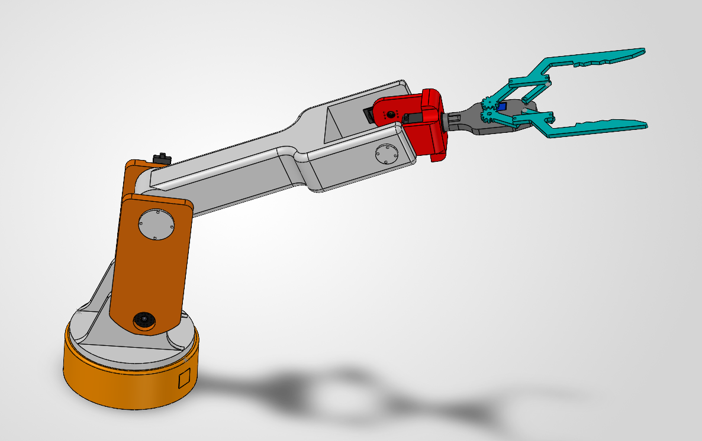
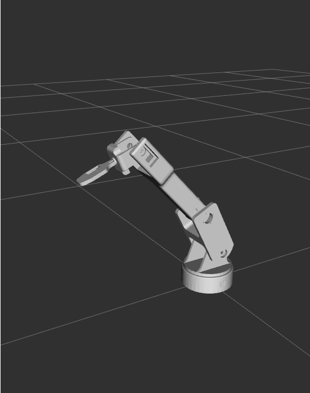
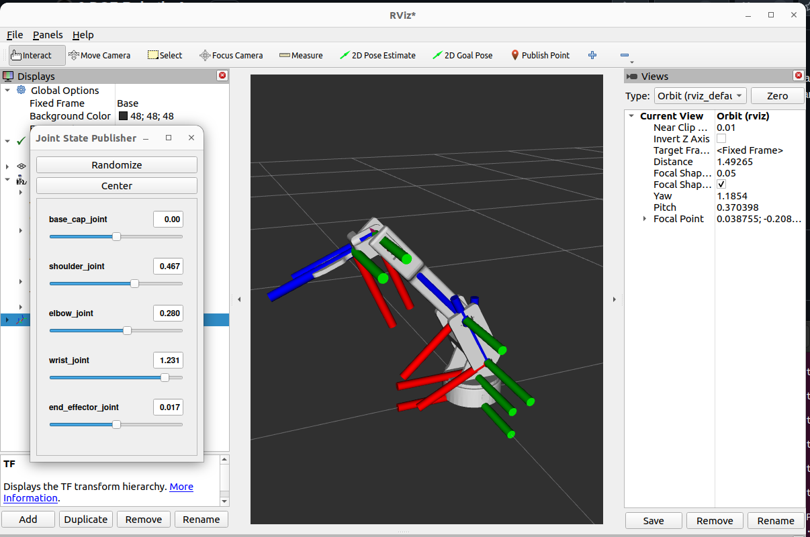
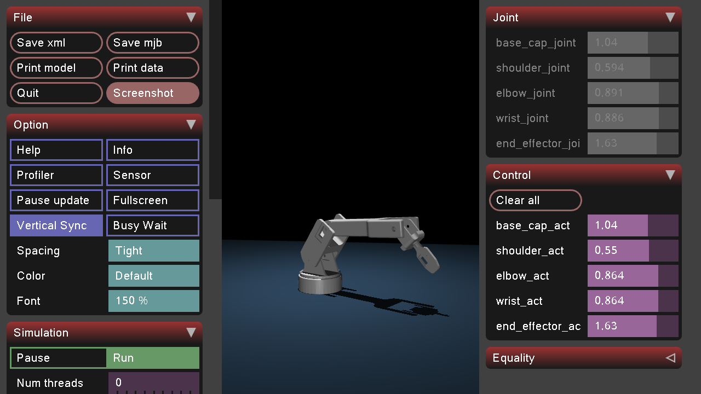

# 6-DOF Robotic Arm

## Overview

This project presents the 3D CAD design of a 6-degree-of-freedom (6-DOF) robotic arm, modeled and assembled using SOLIDWORKS. The repository contains the individual part files (`.SLDPRT`) and the complete assembly file (`.SLDASM`), providing a detailed representation of the arm's mechanical structure and component arrangement.

## Repository Structure

- `*.SLDPRT` — Individual robotic arm components.
- `*.SLDASM` — Complete robotic arm assembly.
- `README.md` — Project documentation.

## Software Requirements

- **SOLIDWORKS** — Required to open and edit the part files and assembly.

## How to Use

1. Clone or download this repository.
2. Open the `.SLDASM` assembly file in SOLIDWORKS.
3. Ensure all referenced `.SLDPRT` files are available so the assembly loads correctly.
4. Explore the assembly to inspect the robotic arm design and its components.

## Visual Preview

<!-- Add a screenshot of the assembled robotic arm below -->



## Build and launch

### 1. Build the Package

Navigate to your ROS 2 workspace:

```bash
cd ~/ros2_ws
```

Build the package:

```bash
colcon build --packages-select <package_name>
```

Source the workspace:

```bash
source install/setup.bash
```

### 2. Launch the Simulation

Run the launch file:

```bash
ros2 launch <package_name> display.launch.py
```

This launches RViz, with the robot URDF and joint state publisher GUI.

## RViz Configuration

In RViz2, configure the following displays:

- **Fixed Frame:** Set the Fixed Frame to **Base link**.
- **TF:** Visualize the robot's coordinate frames.
- **RobotModel:** Set the robot description source to `robot_description`.

Once configured, RViz displays the robot model, coordinate frames and Joint state publisher GUI.




## MuJoCo

### 1. Navigate to your Robotic arm package

```bash
cd path/to/urdf_assembly
```

Moves into the package folder that contains `arm.xml` and `meshes/`.

### 2. Create a virtual environment (first time only)

```bash
python3 -m venv ~/mujoco_env
```

Creates an isolated Python environment at `~/mujoco_env` so MuJoCo doesn't clash with system packages.

### 3. Activate the virtual environment

```bash
source ~/mujoco_env/bin/activate
```

Switches your terminal into that environment. The prompt will show `(mujoco_env)`. Repeat this step every time you open a new terminal.

### 4. Launch the arm in MuJoCo

```bash
python -m mujoco.viewer --mjcf=arm.xml
```

Loads `arm.xml` and opens the viewer window with the arm. Use the **Control** panel on the right to move each joint with the sliders.

### 5. Closing the simulation
Close the simulation window and type the below line. 

```bash
deactivate
```




## Future Developments
- Setting up overhead camera for object detection using OpenCV.
- Camera calibration for converting pixel coordinates to object location coordinates.
- Inverse kinematics and actuation for Visual Manipulation.
